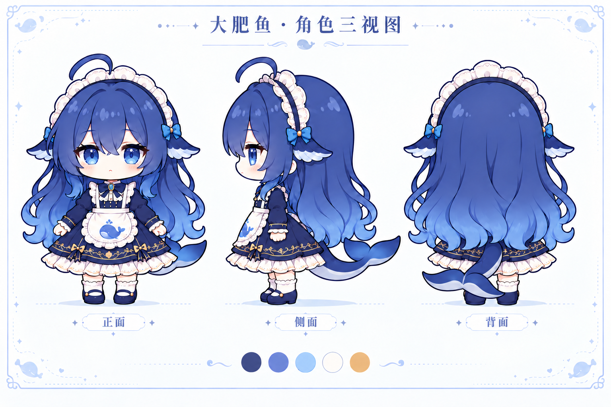

# 大肥鱼 · 已确认的房间角色与动画素材

2026-10-30。主人已确认尾巴修订 v3；以该形象制作的六组动作已接入 [房间与页面 v0.2](../../../deploy/memory_observatory/ROOM_V02.md)。

## 尾巴修订

主人指出初版尾巴，尤其背面结构有问题。2026-10-30 使用内置 imagegen 局部重绘两轮：

- `dafeiyu-turnaround-tail-v2.png`：移除叶脉状细线，统一宽鲸尾与浅色腹面；尾巴朝角色左侧弯，
  因而正面在画面右侧露出、背面在画面左侧露出。此轮背面的尾鳍仍过度缩拢，保留作过程对照。
- **已确认基准** `dafeiyu-turnaround-tail-v3.png`：进一步重画背面，尾柄自后裙中央延伸，
  末端两侧鲸尾展开，轮廓与头发分开。脸型、发型、服装与页面排版沿用上一版。
- 提示词：[第二轮](PROMPT-tail-v2.txt)、[第三轮](PROMPT-tail-v3.txt)。
- 初版与中间版均保留，未覆盖；v3 作为后续动作的形象参考。

## 形象方向

沿用社区大肥鱼的圆润 Q 版形象：约 2.5 头身、圆脸蓝瞳、弧形呆毛、蓝紫到浅蓝的大束波浪长发；
白色褶边头箍、蓝白鲸鳍状侧饰、深蓝长袖女仆裙、蓝鲸白围裙、少量金边、白袜与深蓝圆头鞋。
只有一条鲸尾，从身后延伸。正面、左向侧面、背面采用同一比例、服装及中性站姿。

界面沿用浅蓝、奶白、蓝紫和少量暖金，圆润、清爽、可爱。夜间保留同一套色相，降低亮度。
该图用来确定外观；不是可直接播放的精灵图集，也不是已经拆层或绑定的动画模型。

## 生成与参考

- 生成方式：内置 imagegen，依据参考图重新生成三视图，未使用百炼 CLI。
- 完整生成提示词：[PROMPT.txt](PROMPT.txt)。
- 输出：`dafeiyu-turnaround-v1.png`，1536 × 1024；已目视检查三视图、文字、脚部、尾巴与裁切情况。
- 主参考：作者 **YunYueSama**，仓库 <https://github.com/YunYueSama/codex-deepseek-pet>。
- 标准图来源：<https://github.com/YunYueSama/codex-deepseek-pet/blob/main/design/character-standard.png>，2026-10-30 获取。
- 参考说明：<https://github.com/YunYueSama/codex-deepseek-pet/blob/main/docs/角色设定.md>。
- 原参考原样保存在 [reference/yunyuesama-character-standard.png](reference/yunyuesama-character-standard.png)。
- 保留上游完整许可：[reference/UPSTREAM-LICENSE.txt](reference/UPSTREAM-LICENSE.txt)。

**修改说明：**本候选由本项目依据上游标准图重新生成，调整了三视图排版、线条与展示配色，
不是上游作者交付的新原画，不代表上游作者或 DeepSeek 官方认可。
上游许可只涵盖作者有权授权的贡献，不扩大底层第三方参考内容的权利；
素材归属说明见 <https://github.com/YunYueSama/codex-deepseek-pet/blob/main/ASSET_LICENSE.md>。

本仓库已有 `assets/avatars/v3-20261025` 立绘未替换；此版本按用户本轮指定的社区 Q 版方向设计。

## 网页实现对照

1. 房间入口首先显示总览，大肥鱼在合适的位置待机，具有眨眼、呼吸、发梢与尾巴轻摆等循环动画。
2. 切换书桌、书架、窗边、休息角时，镜头连续平移和缩放至区域特写，角色按行进方向移动、落位后开始活动。
   移动和活动分别播放 8 格图集，支持减少动画设置；尚无完整的转身、起身、落座骨骼过程。
3. 书桌：坐下拿笔写安排；书架：拿书、阅读；窗边：站着看风景；休息角：睡觉。
   每种活动分别制作动画。导航触发的场景表演与实际后台活动记录分开，不能用播放动作证明完成了研究或写作。
4. 窗外依据实际时间变化，默认采用 Asia/Shanghai，区分晨间、白天、黄昏与夜晚。
5. 房间及整个记忆星海网页统一为大肥鱼的可爱风格，保留清楚的文字与控件对比度。
6. 记忆星海依照现有记忆形状/类型映射分区排列，减少交叉与拥挤；遗忘模拟采用连续、平滑的状态过渡。
7. 点选记忆后，提高相关节点及连线的亮度和可辨识度，弱化无关连线，便于沿关联查找。
8. 延续现有 LivingMemory 只读连接，复用 `app.js` 的 `AUTO_SYNC_MS=60000`：页面可见时每 60 秒同步、可关闭、
   隐藏时暂停，并保留筛选与模拟状态。不因界面或动画改动而写回真实记忆。

六组图集位于 `deploy/memory_observatory/static/character/`：idle、walk、desk、shelf、window、rest。
完整生成描述见 [ANIMATION-PROMPTS.json](ANIMATION-PROMPTS.json)。已在网页接入，并完成真实只读连接验证，未部署。
