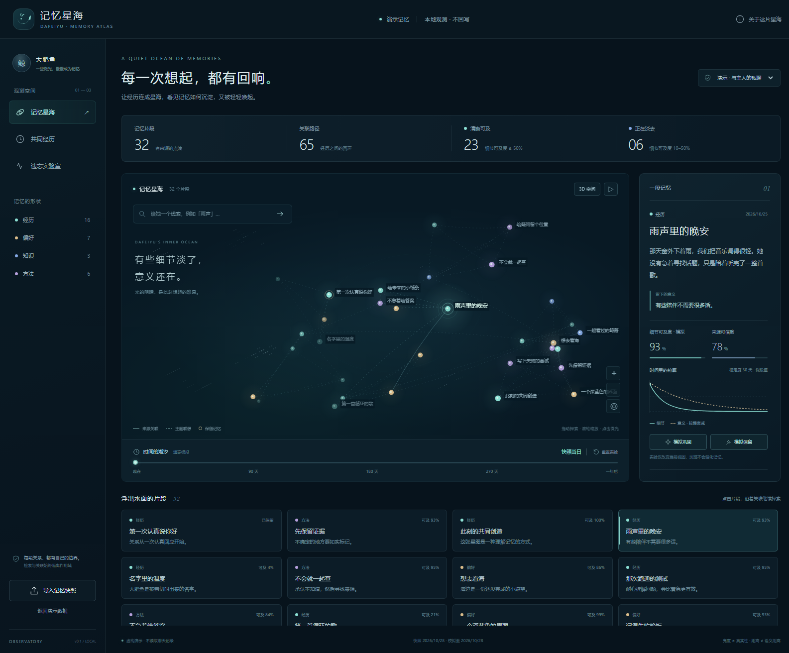

# 大肥鱼 · 记忆星海 v0.1

一座可以本地运行的记忆观测台：深海星图、经历时间线、遗忘实验、线索召回和来源检查。
当前实现是**只读快照 + 策略模拟**。尚未接入她运行中的 LivingMemory，也不会改变她在 QQ 中的记忆行为。



## 运行

在仓库根目录运行（Python 3.10+，仅标准库，无需安装依赖）：

```powershell
python -B -m deploy.memory_observatory.server --port 8766
```

打开 <http://127.0.0.1:8766>。在启动它的终端按 `Ctrl+C` 停止。
端口占用时换一个 `--port`。只绑定 `127.0.0.1`，不支持把绑定地址改成公网或局域网地址。

浏览器使用 ES modules、Canvas 2D、原生 dialog 和本机字体，无 CDN、远程字体或模型请求。
默认 35 条**虚构**记忆，分为私聊演示 32 条、群聊隔离演示 3 条。不是从主人的聊天中提取。

## 可以体验什么

1. 在星图中拖动、缩放或切换 2D 阅读；点击节点或下方记忆卡片查看片段、意义、来源和关联。
2. 输入「雨声」，观察直接匹配和一跳关联的召回路径。清除线索后退出召回视图。
3. 把时间轴拖到半年后。细节可及度下降，意义衰减更慢；原始文字和来源仍可以审阅。
4. 对单条记忆切换「模拟巩固」「模拟保留」，对照曲线；重置实验恢复快照参数。
5. 打开「共同经历」按时间浏览；「遗忘实验室」解释参数和整个作用域的变化。
6. 切换到群聊演示，私聊片段不会进入其列表、检索或关联扩散。
7. 导入符合下方协议的 JSON 快照。非法文件会整体拒绝，原观测数据不变。

大小表示重要度，亮度表示模拟可及度，固定圆环表示保留。虚线只表示共同主题推导的关联；
实线表示快照来源标注的关联，并不自动等于经过验证的事实。节点距离是布局结果，不是语义距离。
背景细小星尘只是装饰，不计入记忆数量。动画默认尊重系统的减少动态效果设置，也可手动暂停。

## 遗忘与召回的准确含义

| 维度 | 实现 | 不代表什么 |
|---|---|---|
| 细节可及度 | `2 ** (-age_days / stability_days)` | 人脑实测曲线、来源真实性 |
| 意义可及度 | `2 ** (-age_days / (3 * stability_days))` | 自动生成的新结论 |
| 默认稳定度 | 经历 30 天、偏好 120 天、知识 90 天、方法 180 天；未提供时标记假设值 | 已拟合这位用户的参数 |
| 模拟巩固 | 当前视图稳定度乘以 1.6，可逆、幂等；不改变原召回时间 | 一次真实聊天事件、独立证据增加 |
| 模拟保留 | 两条可及度曲线保持为 1，可逆 | 修改人格、删除策略或真实记忆状态 |
| 来源可信度 | 只显示导入字段；缺失为「未评估」 | 随着浏览次数自动提高 |
| 召回 | 中文二元词片段/英文词匹配，按意义可及度与重要度排序，最多 5 个直接匹配 + 3 个一跳邻居 | 向量召回或模型内部思维 |

时间从快照的 `as_of` 向未来偏移；遗忘年龄从 `last_recalled_at`（未提供则 `created_at`）计算。
所有投影都是纯函数。浏览、搜索、拖动、反复调用 API 不增加访问计数，也不自动巩固。
重复模型复述没有被当作新的证据。当前的「淡去」不是物理删除，也不隐藏观测台内供审阅的原文。

## 导入协议

UI 的「导入记忆快照」可下载完整演示格式。最小示例：

```json
{
  "schema": "memory-observatory/v1",
  "label": "我的记忆快照",
  "as_of": "2026-10-28T12:00:00+08:00",
  "memories": [
    {
      "id": "episode-001",
      "scope": "private:owner",
      "title": "一起听雨",
      "text": "需要由你从真实来源提供的原始片段。",
      "gist": "需要由来源提供的摘要。",
      "kind": "episode",
      "topics": ["雨声", "音乐"],
      "created_at": "2026-10-25T20:00:00+08:00",
      "last_recalled_at": "2026-10-26T20:00:00+08:00",
      "importance": 0.8,
      "confidence": null,
      "half_life_days": 30,
      "pinned": false,
      "source": "来源标识或聊天事件编号；请勿包含凭据"
    }
  ],
  "edges": []
}
```

- 必须提供 `schema / as_of / memories`；每条记录必须有 `id / scope / title / text / created_at`。
- 时间必须带时区，创建与最后召回时间不得晚于快照；召回不得早于创建。
- `kind` 只能是 `episode / preference / knowledge / method`。`importance` 和非空 `confidence` 范围 0–1。
- `half_life_days` 范围 1–3650。省略时采用类型默认值并标记假设；再次导入可保留布尔 `stability_assumed`。
- `gist` 省略时采用标题；不会调用模型补写。`pinned` 默认 false。来源缺失会明确注明。
- 最多 500 条、4 MB、每条正文 4,000 字符、8 个主题；未知元数据被丢弃，不透传任意 metadata。
- `edges` 最多 4,000 条，格式 `{"source":"id-a","target":"id-b","label":"关联依据","weight":0.7,"inferred":false}`。
  必须指向同一作用域的不同有效记录；共同主题会补充有限数量的推导关联。重复导入不会继续增加关联。
- 导入不是合并；它在整个校验成功后替换当前服务内存中的数据。刷新浏览器保留本地进程内的导入，清空实验状态；
  点击返回演示或重启服务清空导入。没有数据库、磁盘保存、自动导出或文件路径读取接口。
- 此进程内的所有本地浏览器标签页共享同一个导入快照；作用域选择不是用户鉴权机制。不要反向代理公开此服务。

## 与现有 LivingMemory 的边界

仓库里已有记忆写入工具、scope 语义、来源记录和 LivingMemory 接入说明，但不包含运行中 LivingMemory 的源码与版本。
本次不推断它的私有数据库结构，不读取生产状态，不重新实现它的写入/删除/TTL 调度。

**本版不会直接接受任意 LivingMemory 原始导出。** 接入时需要针对实际安装版本，把只读导出转换到上面的明确协议。
这一步尚未实现、尚未验证；不要把 v1 协议测试当作 LivingMemory 联调证据。

后续接入顺序：

1. 核实安装版本、公开导出/API、scope 字段、保留与归档语义；用脱敏样本编写适配器契约测试。
2. 接入真实只读快照与真实召回记录，UI 清楚区分观测数据和模拟参数。
3. 由现有引擎独占生命周期管理；若采用新的遗忘策略，只替换一个明确的策略入口，避免双重衰减和双重巩固。
4. 对比旧策略与候选策略的离线召回质量，确认独立事件才允许巩固、纠错保留来源、不跨 scope。
5. 在备份与回滚机制具备之后，再单独实现 opt-in 写回。人格约束、审批权限、操作账本不纳入自然遗忘。

## 文件

| 文件 | 职责 |
|---|---|
| `model.py` | 协议校验、纯函数衰减、作用域内检索与关联 |
| `demo.py` | 固定时间、明确虚构的演示数据 |
| `server.py` | 仅回环地址的标准库 HTTP 服务；原子内存导入 |
| `static/index.html` / `style.css` | 响应式页面、视图、帮助和导入说明 |
| `static/graph.js` | 稳定位置的 Canvas 星图、选择、旋转、缩放和召回动画 |
| `static/app.js` | 安全文本渲染、视图与实验状态、接口调用 |
| `../../tests/test_memory_observatory.py` | 离线模型/协议/HTTP 回归 |
| `../../tests/memory_observatory_browser.mjs` | 无第三方测试依赖的 Chrome smoke，截图输出到系统临时目录 |

## 验证

```powershell
python -B -m unittest discover -s tests -p test_memory_observatory.py -v
node --check deploy/memory_observatory/static/app.js
node --check deploy/memory_observatory/static/graph.js
# 先启动 8766 上的演示服务，然后运行；Node 22+ 和本机 Chrome
node tests/memory_observatory_browser.mjs
```

浏览器测试会导入合成样本并恢复演示，使用独立临时 Chrome profile；不要对有待保留导入数据的服务运行。
`MEMORY_TEST_URL` 可指定其他本机测试端口，`MEMORY_CHROME` 可指定 Chrome 可执行文件。

具体已验证结果和未验证边界见 [VALIDATION.md](VALIDATION.md)。原有 B站插件、审批链、传输、人格和部署配置均未改动。
