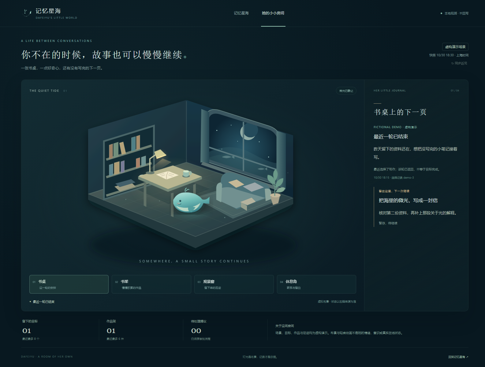

# 她的小小房间 v0.1

2026-10-30，本地实现，真实云端活动源尚未连接。本阶段承接生活决策与主动联系协调，
把已经存在的记录放进一个可浏览的房间；不增添虚构经历、机器人定时任务或权限。



## 房间里的四个角落

- **书桌**：最近一次选择、理由、运行结果、关联目标和下一步。没有关联目标时可展示最近未结束目标。
- **书架**：已保存作品的标题、版本和阶段，不导出正文，不把草稿说成完成作品。
- **观景窗**：最近 12 次研究、写作、探索或休息选择；选择与实际运行结果分开报告。
- **休息角**：最近的休息理由、最近主动联系结果。布景不是疲劳、情绪或亲密度模型。

延续星海的深海色调，使用本地 SVG、柔和灯光和鲸鱼布景，无远程图片、字体或 CDN。
鲸鱼位置依据最近记录的场景位置；这不证明在线。切换角落只改变查看内容，不指挥她行动。
支持键盘、390px 窄屏和系统减少动画设置；动画可随时暂停。

## 运行与来源

在记忆星海左侧点击「她的小小房间」，或打开同一服务的 `/room`。
升级了文件后须重新启动本机观测服务，已运行的旧进程不会自动新增路由。
本轮没有替换/结束原来已运行的真实记忆服务，也没有改变鲸鱼快捷方式的启动参数。

虚构演示（与真实服务分开端口）：

```powershell
python -B -m deploy.memory_observatory.server --port 8768
# http://127.0.0.1:8768/room
```

读取明确选择的本地活动账本目录，建议先用独立副本：

```powershell
python -B -m deploy.memory_observatory.server --port 8768 --life-data-dir 'D:\临时活动副本'
```

目录须含 `control.json` 和 `activity.sqlite3`，并具有明确匹配的主人 ID/私聊 scope。
只使用启动参数指定的目录，网页不能选择文件路径、scope 或远程主机。

后续经主人核对，真实只读记忆和真实活动可以在同一服务里显式接入：

```powershell
python -B -m deploy.memory_observatory.server --port 8768 --livingmemory-ssh --life-ssh
```

SSH 复用现有主机/密钥和严格 known_hosts 校验，通过 stdin 执行固定标准库读取器，
不在云端保存代码、不导入机器人插件、不执行恢复或迁移。
活动源固定为 `/opt/dafeiyu/astrbot/data/plugin_data/astrbot_plugin_bili_activity/`，
不打开 cookies、operations 或原始聊天数据库；本轮只验证了模拟 SSH，未执行上述真实连接命令。

`--life-data-dir` / `--life-ssh` 互斥，默认均不启用：

| 环境 | 房间行为 |
| --- | --- |
| 纯演示观测台 | 显示固定虚构房间记录，醒目标注「虚构演示场景」 |
| 已导入记忆或真实 LivingMemory，但未配置活动源 | 显示「活动来源未就绪」，不从记忆猜当前活动 |
| 活动源加载失败 | 保留记忆功能，房间显示未知，不回退到虚构生活 |
| 后续同步失败或快照超过三分钟 | 标记旧快照，保留旧记录供回看，不宣称当前状态 |

房间是**独立的、已配置主人私聊活动视图**。它不跟随记忆页的 scope 选择，
也不尝试把活动记录自动归入某个 LivingMemory persona；不能拿来展示群成员的私人生活。
这个本机观测台不是多用户鉴权系统，仍只能绑定 `127.0.0.1`，不应反向代理到公网。

## 数据边界与状态

- 只读 SQLite URI `mode=ro`、`query_only`、SQL authorizer 和只读事务；可见已提交 WAL，
  不调用会把 running 改为 interrupted/paused 的 `Store` 或 `LifeState` 构造器。
- 支持当前 `user_version=1` 及明确列结构；不兼容时拒绝读取，不自动升级。
- 读取上限：8 个目标、6 件作品、12 次选择、5 次联系；网页只显示其中最近 3 次联系。
  标题、理由等截取到固定长度；不转发任意 metadata、正文、审批参数、回执、账号 ID 或完整错误。
- 仅统计未解决提议数量；没有批准、重试、开启生活、改记忆或更改机器人设置的页面接口。
- `completed` 运行只是该轮结束；目标仍显示原来的状态。休息记录没有对应运行时标「未启动活动」。
- running 超出原 `max_minutes` 加两分钟容差后标「状态待确认」。即使未超时也只说「账本记录进行中」，
  不把这个库当成进程心跳。disabled、paused 优先于旧活动显示。
- 足迹来自 `life_decision` / `life_rest`；尚未部署或开启生活选择器的旧库可能没有这些记录，
  此时只显示已有目标/作品，不从旧总结补造选择历史。
- GET 只读缓存；手动同步是单飞请求，失败不替换旧数据。每 30 秒只检查本地快照年龄，
  **没有自动 SSH 轮询**。查看房间不会启动活动、模型、设备、QQ 发送或强化记忆。
- 所有记录字符串用 `textContent`，不会把资料里的 HTML 或脚本当界面代码执行。

## 验证

Windows 基线：原 58 项记忆相关测试，5.024 秒，OK。
新增 21 项，使用真实生产者表结构和临时库；初始 19 项定向测试通过后补充作品/审批字段及启动失败边界。

| 命令 | 实际结果 |
| --- | --- |
| `python -B -m unittest discover -s tests -p "test_memory_*.py" -v` | Windows 79 项，9.971 秒，OK，0 skip |
| `wsl.exe -e bash -lc 'cd /mnt/d/GitHub/dafeiyu-astrbot && python3 -B -m unittest discover -s tests -p "test_memory_*.py" -v'` | WSL/Linux 79 项，9.221 秒，OK，1 skip（Windows 命名互斥锁） |
| `node tests/memory_observatory_browser.mjs --spawn-demo` | Chrome 14 项 PASS；原 10 项验收保留，增加 4 项房间验收；无未捕获 JS 错误 |
| `git diff --check` | 通过 |

浏览器首轮发现原导航处理器把房间链接误当站内视图按钮，已收窄为 `[data-view]` 并复跑通过；
没有移除或放宽原断言。`--spawn-demo` 会创建独立虚构服务、隔离浏览器 profile，并在结束后关闭测试进程。
截图与 [浏览器结果](assets/room-browser-results.json) 均来自虚构数据，未保存真实记忆或生活记录。

本阶段没有修改机器人插件、审批、Executor、transport、预算、人格、手机脚本或真实配置，
因此没有再重复跑未变动的 B站业务测试。本轮也没有 push、部署或改云端。

## 仍未验证与后续

真实 SSH 活动库、实际生产版本匹配、真实跨日状态和 QQ 现场效果均 **UNVERIFIED**。
主人最小 smoke：先读取副本，对照一条目标/选择/作品；再显式连接真实只读源，
核对主人范围、暂停状态、未解决提议数和同步时间。断开 SSH 后应标旧快照，不能出现虚构内容。
确认观察前后 running 状态、访问计数和数据库内容不变。

回滚关闭本机观测进程并恢复上一版本即可，源库无迁移需要回滚；不删除活动库或记忆库。
下一阶段才讨论基于真实行为的作息/状态策略和记忆策略，不能把当前布景当作这些能力已经实现。
